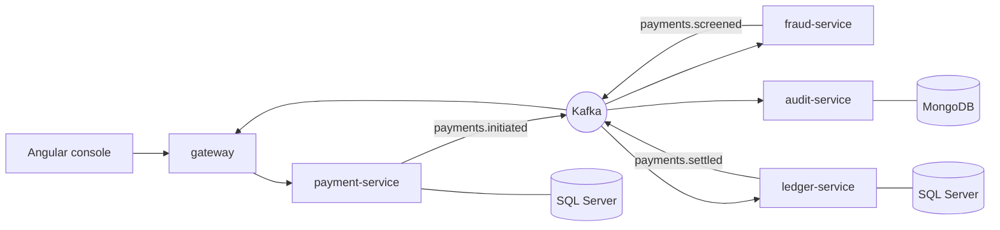

# PayStream

A payments backend I built on how banks move money without losing or duplicating it. A payment comes in through a REST API, goes through Kafka to a fraud service, gets settled in a double-entry ledger, and every step is written to an audit log. There's console on top to watch it happen.

Java 21 · Spring Boot 3 · Kafka · SQL Server · MongoDB · Angular 21 · Docker · Kubernetes

## Demo 

https://github.com/user-attachments/assets/adee940b-b594-4943-8394-28eae2a1f144

## What it does



- **payment-service** takes the request, stores it and writes a `PaymentInitiated` event to an outbox table in the same transaction. A relay publishes the outbox to Kafka.
- **fraud-service** scores each payment with a few rules: hard limit, high value, amounts just under the reporting threshold (structuring), too many payments from one account in a minute (velocity), and high-risk countries. Score ≥ 70 is rejected.
- **ledger-service** settles approved payments: it locks both accounts, checks funds, and writes one debit and one credit.
- **audit-service** stores every event in MongoDB so you can see a payment's full history.
- **gateway-service** sits in front of everything for the UI. It handles login, rate limiting, and streams Kafka events to the browser over Server-Sent Events.

## Running it

You need Docker with about 6 GB of memory available.

```bash
docker compose up -d --build
```

Open http://localhost:4200, click **Continue as reviewer**, and try the scenarios on the dashboard. The load burst sends 200 payments; the others show the fraud rules and ledger checks failing on purpose.

Other things that come up:

- Swagger for the payments API: http://localhost:8081/swagger-ui.html
- Grafana: http://localhost:3000 (dashboard "PayStream Overview")
- Kafka UI, if you want it: `docker compose --profile tools up -d kafka-ui`, then http://localhost:8090

To work on the frontend with hot reload, leave the backend running in Docker and run `npm ci && npx ng serve` in `frontend/`.

## Design notes

**Not losing events.** You can't write to the database and publish to Kafka atomically, so the payment and its event go into the database together (the outbox pattern). A scheduled relay sends unpublished rows to Kafka and marks them done. If it crashes in between, the event gets sent twice, which is fine because of the next point.

**Not settling twice.** Kafka is at-least-once, so the ledger will see duplicates. The `settlements` table uses the payment id as its primary key. A duplicate finds the existing row and gets the same result back, and nothing is posted again. This also covers the case where the ledger commits but crashes before publishing the result: the event is redelivered and the stored outcome is published.

**Retries from clients.** `POST /payments` requires an `Idempotency-Key`. The same key with the same body returns the original payment. The same key with a different body is a 422. Two identical requests racing each other are sorted out by a unique constraint.

**Ordering.** All topics are keyed by the debtor's account number, so one account's events always go to the same partition and the same consumer. That's what lets the velocity rule keep its counts in memory. The downside is that the counts reset when partitions get rebalanced.

**Events arriving out of order.** Screening results and settlement results are on different topics, so the payment service sometimes sees "settled" before "approved". The payment status only moves forward, so a late event is ignored instead of moving it backwards.

**Failures.** Consumers retry with back-off and then send the message to a `.DLT` topic, so one bad message doesn't block a partition.

## Things that went wrong (and what I changed)

These came up while load-testing locally and taught me more than anything else in the project.

- **The ledger was processing one payment at a time.** I first locked both accounts with a single `WHERE account_number IN (...) ORDER BY ...` query. On SQL Server, Hibernate adds `HOLDLOCK` for pessimistic locks, and on a small table the optimiser chose a scan. A serializable scan takes range locks, so every settlement blocked every other one, even between unrelated accounts. I found it through `LCK_M_RS_U` waits in `sys.dm_exec_requests`. The fix was to lock each account separately by primary key, still in sorted order so two opposite transfers can't deadlock.
- **Everything was slow because the machine was swapping.** No container had a memory limit, so every JVM sized its heap from the whole Docker VM, and the VM ended up 3.7 GB into swap. Adding memory limits fixed most of the latency.
- **The live feed showed empty rows during bursts.** The feed keeps the last 50 payments. A "settled" event for a payment that had already dropped off the list was being added back as a new row with no details. Now only the first event for a payment can create a row.
- **The ledger page sometimes showed the wrong account's entries.** Two requests raced, and the slower, older one overwrote the newer one. Responses for an account that's no longer selected are now ignored.

Numbers from my laptop (Docker on Windows, everything in one VM) aren't meaningful, so I haven't put any here. `loadtest/` has a k6 script and a burst script if you want to measure on real hardware.

## Tests

```bash
mvn verify                                  # 39 tests
cd frontend && npx ng test --watch=false    # 11 tests
```

The payment-service tests run against an embedded Kafka broker and the real Flyway migrations (H2 in SQL Server mode). They check the outbox actually reaches Kafka, idempotent retries, validation errors, auth, and the status moving to `SETTLED`. The ledger tests cover duplicates, insufficient funds and the debit/credit balance. The gateway tests cover login, auth, rate limiting and a downstream service being down.

## Deployment bits

- `k8s/`: Kustomize manifests (probes, resource limits, HPA, Ingress). Written for OpenShift as well; not deployed anywhere right now.
- `.gitlab-ci.yml`: build, tests, SAST and dependency scanning, SonarQube, image build, Trivy scan, manual deploy step.
- `.github/workflows/ci.yml`: runs the backend and frontend tests on every push.

## If I kept going

- Kafka transactions in the fraud service, so reading the input and writing the result commit together.
- Avro or Protobuf schemas instead of JSON.
- Tracing across services with OpenTelemetry.
- Testcontainers tests against real SQL Server and Kafka.
- Real OIDC login instead of the demo token.

All accounts and payments are made up.
