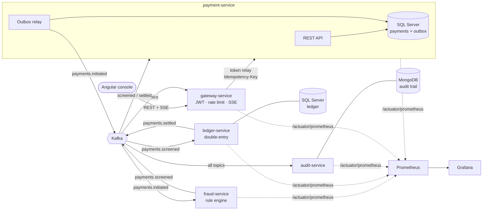
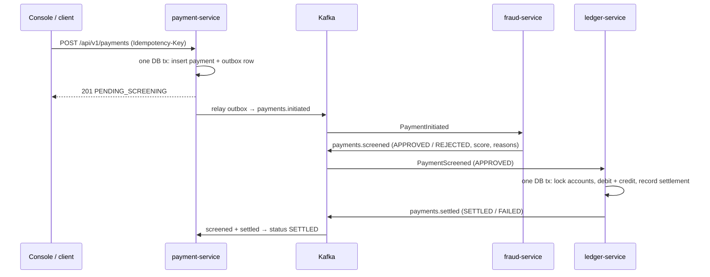

# PayStream

An event-driven, real-time payments platform: Spring Boot microservices that talk over Apache Kafka, with an Angular operations console. It takes a payment through **intake → fraud screening → double-entry settlement → audit**, and it is built to the correctness standards a bank needs. No payment is lost, none is settled twice, and every movement of money can be traced.

     

**▶ [Watch the 1-minute demo](docs/paystream-demo.mp4)**: a load burst, fraud rules firing, a payment's journey across services, and the double-entry ledger, recorded from the running system.

## Architecture



| Component | Responsibility | Storage | Port |
|---|---|---|---|
| `frontend` | Angular 21 operations console: live feed, scenario launcher, payment journey, ledger, architecture | – | 4200 |
| `gateway-service` | Backend-for-frontend: demo sign-in (JWT), token relay to services, Kafka → SSE live stream, real-time KPIs, scenario runner, per-IP rate limiting | in-memory | 8085 (host) |
| `payment-service` | Public payments API, idempotent intake, payment state machine, transactional outbox, JWT auth | SQL Server | 8081 |
| `fraud-service` | Real-time scoring: high value, hard limit, structuring, velocity (sliding window), high-risk jurisdiction | in-memory, partition-local | 8082 |
| `ledger-service` | Double-entry settlement, balance checks, ledger integrity control | SQL Server | 8083 |
| `audit-service` | Immutable, per-payment audit timeline across every topic | MongoDB | 8084 |
| `common-events` | Versioned event contracts (`sealed interface` + records) shared by all services | – | – |

### Payment lifecycle



## Engineering decisions

These are the parts worth discussing in a design review.

**1. Transactional outbox, so no event is lost and none is made up.** Writing to the DB and publishing to Kafka can't be made atomic (the dual-write problem). The payment row and its `PaymentInitiated` event are committed in **one SQL transaction**, and a relay publishes pending outbox rows afterwards. It sends each batch asynchronously and then waits for the broker acks, and it marks rows published with a single bulk `UPDATE`. A `paystream.outbox.pending` gauge shows any backlog. → [`OutboxWriter`](payment-service/src/main/java/com/paystream/payment/outbox/OutboxWriter.java), [`OutboxRelay`](payment-service/src/main/java/com/paystream/payment/outbox/OutboxRelay.java)

**2. Idempotent API.** Clients send an `Idempotency-Key`. A retry with the same key and body returns the original payment (`200` + `Idempotent-Replayed: true`). The same key with a different body is rejected with `422`, detected via a SHA-256 fingerprint of the request. If two identical requests race, the database `UNIQUE` constraint decides the winner and the loser replays it. → [`PaymentService`](payment-service/src/main/java/com/paystream/payment/service/PaymentService.java)

**3. Settlement is exactly-once in effect.** Kafka delivers at least once. The ledger's `settlements` table is keyed by `payment_id`, so a redelivered event **can never post twice**. A redelivery replays the *stored* outcome instead, which means a crash between the DB commit and the Kafka publish heals itself on redelivery without needing a second outbox. Event IDs are deterministic (`UUID v3` of stage + paymentId), so a re-emitted event can be recognised downstream. → [`SettlementService`](ledger-service/src/main/java/com/paystream/ledger/service/SettlementService.java)

**4. No deadlocks under concurrent transfers, and no false contention.** The ledger takes pessimistic row locks (`UPDLOCK`) on both accounts **in a fixed (sorted) order**, which rules out the classic A→B / B→A deadlock. Each lock is a primary-key point lookup on purpose. An earlier version locked both rows with one `IN (...) ORDER BY` query, which SQL Server planned as a scan; under `HOLDLOCK` that scan took **key-range locks** (`LCK_M_RS_U` waits) that serialised every settlement, even between unrelated accounts. Lock failures are retried with exponential back-off before a record goes to the DLT. A `CHECK (balance >= 0)` constraint backs up the application check at the database level. → [`AccountRepository`](ledger-service/src/main/java/com/paystream/ledger/domain/AccountRepository.java)

**5. Ordering through partition keys.** Every topic is keyed by the debtor account, so all events for one account are handled in order by a single consumer. The fraud velocity window can therefore stay in local memory with no distributed lock. The trade-off is that the window resets after a rebalance; a Kafka Streams state store or Redis would remove that.

**6. Events arriving out of order across topics.** `screened` and `settled` are separate topics, so the payment service may see a settlement before the screening result. The state machine accepts that and rejects any backwards move (e.g. `SETTLED → APPROVED`). Duplicates are no-ops, so every handler is idempotent. → [`PaymentStatus`](payment-service/src/main/java/com/paystream/payment/domain/PaymentStatus.java)

**7. Resilience.** Producers use `acks=all` with the idempotent producer enabled, plus lz4 compression and batching. Consumers use `ErrorHandlingDeserializer` so a poison message can't wedge a partition, exponential back-off retries, and dead-letter topics (`<topic>.DLT`).

**8. Controls.** `GET /api/v1/ledger/integrity` checks that total debits equal total credits per currency. The audit service keeps the full cross-service journey of each payment, with the topic, partition and offset of every event, for investigations.

**9. Secure by default.** Endpoints require a stateless JWT with per-scope authorisation (`payments:write` / `payments:read`), and anything not explicitly allowed is denied. Services **won't start** without a ≥256-bit signing secret. Errors come back as RFC 9457 problem details and never include internals. The outbox relay only deserialises types from the events package. Containers run as non-root with a read-only root filesystem and all capabilities dropped.

**10. Built for throughput.** It uses Java 21 virtual threads for request and listener handling, a batch Kafka consumer with bulk Mongo writes in the audit service, per-poll offset commits, explicit container memory budgets, HikariCP pooling, `READ_COMMITTED_SNAPSHOT` so readers don't block writers, layered Docker images, and HPAs bounded by partition count.

**11. Backend-for-frontend.** The browser talks to a single origin and auth model. The gateway exposes only whitelisted endpoints (no open proxy) and relays the user's token, so each service still enforces its own authorisation. Every gateway instance consumes Kafka with its own consumer group and fans events out to its browsers over SSE. A token-bucket limiter per client IP protects the public demo, with a much tighter bucket for scenario launches because each one fans out into many payments. → [`gateway-service`](gateway-service/src/main/java/com/paystream/gateway)

## Operations console (Angular)

The console is what a reviewer clicks through. It's built with **Angular 21** (standalone components, signals, zoneless change detection, lazy-loaded routes) on **Angular Material 3**, re-skinned with a custom design system: neutral surfaces, Geist / Geist Mono type, tabular figures for money, and automatic light/dark mode.

| Screen | What it shows |
|---|---|
| **Dashboard** | KPIs computed live from the event stream (throughput, approval rate, settlement success, p50/p95 end-to-end latency), a 60-second throughput chart, a breakdown of rejection reasons, a **live payment feed** whose rows update in place as Kafka events arrive, and a **scenario launcher** (happy path, insufficient funds, high-risk jurisdiction, hard limit, currency mismatch, structuring burst, 200-payment load burst) |
| **Payments** | Recent payments from SQL Server with status filters, plus a **New payment** form. Its client-side validation mirrors the API's Bean Validation rules, server field errors are mapped back onto the form, and each form keeps one `Idempotency-Key` so a retry can never pay twice |
| **Payment journey** | A per-payment timeline from the MongoDB audit trail showing each hop with timestamp, time since intake, Kafka topic/partition/offset, the fraud decision with its score and reasons, the settlement outcome, and the raw event payload |
| **Ledger** | Account balances, the double-entry journal per account, and a live **debits = credits** integrity check |
| **Architecture** | The system diagram, the payment lifecycle and the main design decisions, written for non-specialists |

How it's put together:
- **One live connection.** A single `EventSource` (SSE) connection, shared by every screen, reconnects with capped exponential back-off. A pure, unit-tested reducer merges events into the feed and only ever moves a status forward, even when events arrive out of order across topics.
- **Gateway, not direct service calls.** The browser only talks to `/api` on its own origin. nginx proxies it to the gateway.
- **Hardened delivery.** The console runs on unprivileged nginx with a strict CSP, `X-Frame-Options: DENY`, `nosniff`, immutable caching for hashed bundles, and SSE proxied with buffering off. The production bundle is about 125 kB transferred on first load.

## Run it locally

Requirements: Docker (≈6–8 GB RAM for the full stack), plus Java 21 + Maven 3.9 and Node 22 if you want to build or test outside Docker.

```bash
docker compose up -d --build
```

Then open **http://localhost:4200**, click **Enter as reviewer**, and run a scenario from the dashboard.

| What | URL |
|---|---|
| **Operations console** (start here) | http://localhost:4200 |
| Gateway API | http://localhost:8085/api |
| Payment API (Swagger UI) | http://localhost:8081/swagger-ui.html |
| Ledger API | http://localhost:8083/api/v1/accounts |
| Audit API | http://localhost:8084/api/v1/audit/payments/{paymentId} |
| Kafka UI (optional: `docker compose --profile tools up -d kafka-ui`) | http://localhost:8090 |
| Grafana (dashboard "PayStream Overview") | http://localhost:3000 |
| Prometheus | http://localhost:9090 |

Frontend development with hot reload (the backend runs in Docker, and `/api` is proxied to `localhost:8085`):

```bash
cd frontend && npm ci && npx ng serve
```

### Try the API directly

```bash
# 1. Get a dev token (local profile only)
TOKEN=$(curl -s -X POST localhost:8081/auth/token | sed -E 's/.*"access_token":"([^"]+)".*/\1/')

# 2. Send a payment
curl -s -X POST localhost:8081/api/v1/payments \
  -H "Authorization: Bearer $TOKEN" -H "Content-Type: application/json" \
  -H "Idempotency-Key: demo-0001" \
  -d '{"debtorAccount":"GB82PAYS10000000000001","creditorAccount":"GB82PAYS10000000000002","amount":1250.00,"currency":"GBP","beneficiaryCountry":"GB"}'

# 3. Send the exact same request again -> 200 with the same id (idempotent replay)
# 4. Check its status (PENDING_SCREENING -> APPROVED -> SETTLED within milliseconds)
curl -s localhost:8081/api/v1/payments/<id> -H "Authorization: Bearer $TOKEN"

# 5. See its journey across all services, and the ledger controls
curl -s localhost:8084/api/v1/audit/payments/<id>
curl -s localhost:8083/api/v1/ledger/integrity
```

Scenarios to try with the seeded accounts (all one click in the console):

| Scenario | Request | Result |
|---|---|---|
| Happy path | `...0001 → ...0002`, 1250 GBP, `GB` | `SETTLED` |
| Insufficient funds | `...0004 → ...0002`, 900 GBP (balance 500) | `FAILED / INSUFFICIENT_FUNDS` |
| Sanctions-style block | any, `beneficiaryCountry: "IR"` | `REJECTED / HIGH_RISK_JURISDICTION` |
| Over hard limit | any, 60000 GBP | `REJECTED / AMOUNT_EXCEEDS_HARD_LIMIT` |
| Structuring + velocity | six payments of 9500 GBP within a minute | 6th `REJECTED` |
| Currency mismatch | `...0001 → DE89PAYS20000000000001`, GBP | `FAILED / CURRENCY_MISMATCH` |

### Load test

```bash
k6 run -e RATE=300 -e DURATION=2m loadtest/payments.js
```

Watch throughput, p95 latency, outbox backlog and consumer lag in Grafana (or on the console dashboard) while it runs.

## Testing

```bash
mvn verify                                   # 39 backend tests
cd frontend && npx ng test --watch=false     # 10 frontend tests (Vitest)
```

- **Domain unit tests**: the payment state machine (parameterised transition table), and every fraud rule including sliding-window expiry and de-duplicating a redelivered event.
- **Integration tests**: run against an **embedded Kafka broker** and the **real Flyway migrations** (H2 in SQL Server mode). They cover the outbox reaching Kafka, idempotent replay and key-reuse conflicts, validation problem details, 401/403 scope enforcement, and downstream events moving a payment to `SETTLED`.
- **Ledger tests**: balanced double entry, duplicate delivery posting exactly once, insufficient funds, unknown account and currency mismatch.
- **Gateway tests**: the real security chain (a demo-issued JWT is accepted, missing or forged tokens get 401), a downstream outage maps to 503, the rate limiter returns 429 with `Retry-After`, and the live KPI aggregation (counts, reasons, latency percentiles, the throughput window) is checked.
- **Frontend tests**: the live-feed reducer (ordering, out-of-order events, bounding, immutability), the pipes, and status-chip rendering.
- JaCoCo coverage reports are written to `*/target/site/jacoco`.

## CI/CD and deployment

- **GitLab CI** ([`.gitlab-ci.yml`](.gitlab-ci.yml)): compile → backend tests (JUnit reports + coverage) and frontend tests + production build → GitLab SAST, dependency and secret scanning → SonarQube quality gate → Docker build per service plus the console → container scan (Trivy; Prisma Cloud's `twistcli` or the Wiz CLI fit the same slot) → manual deploy to **OpenShift** with `oc apply -k`.
- **GitHub Actions** ([`.github/workflows/ci.yml`](.github/workflows/ci.yml)): backend `mvn verify`, plus frontend tests and the production build, on every push and PR.
- **Kubernetes / OpenShift** ([`k8s/`](k8s)): Kustomize base with Deployments (startup/liveness/readiness probes, resource limits, rolling updates with zero unavailability, restricted security context), Services, PodDisruptionBudgets, HPAs, and an Ingress with TLS. Secrets are placeholders meant to be supplied by Vault / External Secrets.

## Project layout

```
common-events/     event contracts (sealed interface PaymentEvent + records), topic names
payment-service/   REST API, idempotency, outbox, state machine, JWT security
fraud-service/     rule engine (strategy pattern), sliding-window velocity tracker
ledger-service/    double-entry ledger, ordered locking, idempotent settlement, integrity API
audit-service/     batch Kafka consumer -> MongoDB timeline
gateway-service/   BFF: demo auth, token relay, Kafka -> SSE, live KPIs, scenarios, rate limiting
frontend/          Angular 21 + Material 3 operations console, nginx image
infra/             Prometheus, Grafana dashboard, SQL Server init
k8s/               Kustomize manifests for Kubernetes / OpenShift
loadtest/          k6 scenario
```

## What I would add next

- Kafka transactions (`read-process-write`) in the fraud service, so the consumed offset and the produced result commit atomically.
- Avro/Protobuf with a Schema Registry for contract evolution, replacing JSON type headers.
- Distributed tracing (Micrometer Tracing + OpenTelemetry), with the trace id carried in Kafka headers.
- Testcontainers suites against real SQL Server, Kafka and MongoDB, plus Playwright end-to-end tests for the console.
- OIDC sign-in (authorization code + PKCE) in place of the demo reviewer token.
